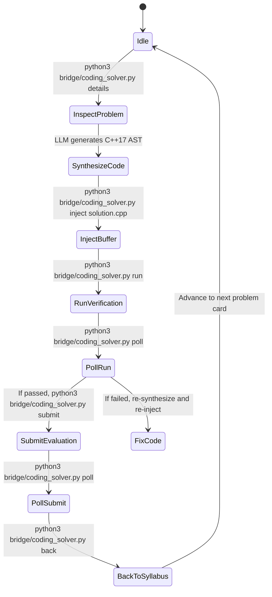
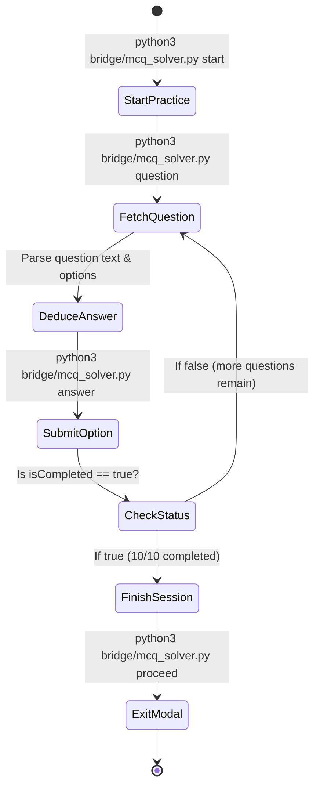

# CCBP Autonomous AI Agent Playbook & Standard Operating Procedure (SOP)

> **Audience**: AI Coding Agents, LLM Subagents, and Browser Automation Bots.  
> **Mission**: Autonomously solve Coding Practices and MCQ Practices on the CCBP Learning Portal (`https://learning.ccbp.in`) with 100% test case pass rates, zero human intervention, and strict zero-prompt remote debugging security.

---

## 🚨 PRIME DIRECTIVE: Rule 1 Compliance (Single Remote Debugging Grant)

### The Constraint
Modern Google Chrome (v128+ on Linux / Wayland) enforces strict security dialogues whenever a new remote debugging client connects to Chrome DevTools Protocol (CDP).
**NEVER** perform any of the following:
- ❌ Do **NOT** spawn ephemeral browser instances via Puppeteer, Playwright, or Selenium.
- ❌ Do **NOT** open short-lived WebSocket connections to port `9222`.
- ❌ Do **NOT** trigger repeated permissions or close/reopen CDP ports.

### The Standard IPC Interface
All browser automation **MUST** communicate exclusively through the local persistent bridge daemon:
```
Base URL: http://127.0.0.1:9999
```

| HTTP Endpoint | Method | Payload / Arguments | Purpose |
| :--- | :---: | :--- | :--- |
| `/status` | `GET` | *None* | Verifies connection health, active tab target, and CDP sessionId |
| `/eval` | `POST` | `{"expression": "<js_code>"}` | Evaluates JavaScript expression in page context ($\le 2\text{ ms}$) |
| `/screenshot` | `POST` | `{"path": "/absolute/path.png"}` | Captures high-res screenshot without interrupting UI |
| `/reattach` | `GET` | *None* | Re-discovers and re-attaches to CCBP tab if URL navigation occurred |

---

## 🛠️ Agent Toolkit Reference (`bridge/`)

Two automated CLI tools are provided in `bridge/` so AI agents can execute multi-step workflows with single-line terminal commands:

### 1. `bridge/coding_solver.py`
```bash
# 1. Inspect active problem title, description, and editor starter code:
python3 bridge/coding_solver.py details

# 2. Inject C++ solution directly into Ace editor buffer:
python3 bridge/coding_solver.py inject solution.cpp

# 3. Click Run Code (sample test cases):
python3 bridge/coding_solver.py run

# 4. Click Submit Code (hidden test cases):
python3 bridge/coding_solver.py submit

# 5. Poll for test runner results:
python3 bridge/coding_solver.py poll

# 6. Navigate back to syllabus and dismiss any unsaved changes modal:
python3 bridge/coding_solver.py back

# 7. Re-attach bridge if tab changed:
python3 bridge/coding_solver.py reattach
```

### 2. `bridge/mcq_solver.py`
```bash
# 1. Fetch current question, options (0-indexed), progress, and completion status:
python3 bridge/mcq_solver.py question

# 2. Answer question with option index (e.g., 2 for third option), submits and clicks NEXT:
python3 bridge/mcq_solver.py answer 2

# 3. Exit completion modal (10/10 correct screen) back to syllabus:
python3 bridge/mcq_solver.py proceed

# 4. Launch next practice session from syllabus:
python3 bridge/mcq_solver.py start
```

---

## 🔄 Autonomous Workflow State Machines

### 1. Algorithmic Coding Practice State Machine



#### Step-by-Step SOP for Coding Practices:
1. **Extract State**: Run `python3 bridge/coding_solver.py details`. Read title, Markdown description, and `starterCode`.
2. **Examine Starter Code**:
   - Identify whether the portal supplies I/O harnesses (e.g., `int main()` with driver reading from standard input) or expects a function/class implementation (e.g., `class Queue { ... }`).
   - Check if node structs (like `struct Node { int data; Node* next; };`) are pre-defined. Do not re-define pre-existing structs to avoid duplicate symbol compilation errors.
3. **Synthesize Solution**:
   - Target optimal algorithmic complexity ($O(N)$ or $O(N \log N)$).
   - Use standard C++17 (`#include <iostream>`, `#include <vector>`, `#include <stack>`, etc.).
   - Ensure clean null pointer and edge case handling (empty inputs, single element, boundary values).
4. **Buffer Injection**:
   - Write synthesized solution to `/tmp/solution.cpp`.
   - Run `python3 bridge/coding_solver.py inject /tmp/solution.cpp`.
5. **Run Sample Cases**:
   - Run `python3 bridge/coding_solver.py run`.
   - Poll with `python3 bridge/coding_solver.py poll`. Verify sample test cases pass.
6. **Submit Hidden Cases**:
   - Run `python3 bridge/coding_solver.py submit`.
   - Poll with `python3 bridge/coding_solver.py poll` until `"Testcases Passed"` appears.
7. **Navigate Back**:
   - Run `python3 bridge/coding_solver.py back`.
   - The script automatically checks for and dismisses the `"Do you want to save code before leaving? YES | NO"` modal by clicking `"YES"`.

---

### 2. MCQ Practice State Machine



#### Step-by-Step SOP for MCQ Practices:
1. **Fetch Question**:
   - Run `python3 bridge/mcq_solver.py question`.
   - Output JSON format:
     ```json
     {
       "question": "What is the maximum number of nodes at level L of a binary tree?",
       "options": [
         {"index": 0, "text": "2^L"},
         {"index": 1, "text": "2^(L-1)"},
         {"index": 2, "text": "L^2"},
         {"index": 3, "text": "2L"}
       ],
       "progress": "QUESTIONS ATTEMPTED: 3/10",
       "isCompleted": false
     }
     ```
2. **Compute Option Index**:
   - AI Agent analyzes mathematical or algorithmic properties.
   - Identifies the matching 0-based `index` (e.g., `0` for $2^L$).
3. **Select & Advance**:
   - Run `python3 bridge/mcq_solver.py answer <index>`.
   - This executes option radio button selection, triggers `"SUBMIT"`, and clicks `"NEXT"`.
4. **Handle Session Finish**:
   - When question 10 is submitted, `isCompleted` becomes `true`.
   - Run `python3 bridge/mcq_solver.py proceed` to dismiss the score summary screen and return to the course tree.

---

## 📋 Comprehensive DOM Selector & API Catalog

### Coding Practice DOM Selectors
| Purpose | JavaScript / DOM Selector |
| :--- | :--- |
| **Open Problem Card $i$** | `document.querySelectorAll('[data-testid="card-container"]')[i].click()` |
| **Switch to Code Tab** | `Array.from(document.querySelectorAll("div, button, a")).find(el => el.textContent.trim() === "Code").click()` |
| **Switch to Summary Tab** | `Array.from(document.querySelectorAll("div, button, a")).find(el => el.textContent.trim() === "Summary").click()` |
| **Direct Ace Editor Set** | `ace.edit("codingQuestionEditor").setValue(code, -1)` |
| **Get Current Code** | `ace.edit("codingQuestionEditor").getValue()` |
| **Trigger Run** | `document.getElementById("runCode").click()` |
| **Trigger Submit** | `document.getElementById("submitCode").click()` |
| **Back Button Navigation** | `document.querySelector('[data-testid="practice-header-back-button"]').click()` |
| **Exit Save Dialog** | `Array.from(document.querySelectorAll("button")).find(b => b.innerText.trim() === "YES").click()` |

### MCQ Practice DOM Selectors
| Purpose | JavaScript / DOM Selector |
| :--- | :--- |
| **Start Practice Button** | `Array.from(document.querySelectorAll("button")).find(b => b.innerText.trim() === "START PRACTICE").click()` |
| **Question Container** | `document.querySelector(".markdown-body, [class*=\"MarkdownTextContainer\"]")` |
| **Option Label $i$** | `document.querySelectorAll("label.radioButtonLabel")[i]` |
| **Submit Button** | `Array.from(document.querySelectorAll("button")).find(el => el.innerText.trim() === "SUBMIT")` |
| **Next Button** | `Array.from(document.querySelectorAll("button")).find(el => el.innerText.trim() === "NEXT")` |
| **Proceed / Modal Exit** | `document.querySelector("button.StartButton-gjsfIy")` (or button with text `"PROCEED"`) |

---

## 🛡️ Autonomous Error Recovery & Self-Healing

| Failure Scenario | Root Cause | Self-Healing Autonomous Action |
| :--- | :--- | :--- |
| **Connection Refused on `:9999`** | Bridge daemon process terminated. | Run `python3 bridge/bridge.py` in background (`IsDaemon: true`). Confirm via `curl -s http://127.0.0.1:9999/status`. |
| **Ace Editor Not Loaded** | Page still rendering or in "Summary" tab. | Click "Code" tab via `bridge/coding_solver.py` or dispatch click on the tab container, then retry after 500ms. |
| **Navigation Corrupted / 404** | Direct URL change or history desync. | Call `python3 bridge/coding_solver.py reattach` to re-synchronize the bridge sessionId with the current page. |
| **Modal Stalling Back Navigation** | Unsaved code modal prompt. | Click `button` containing `"YES"` (`python3 bridge/coding_solver.py back` does this automatically). |
| **Submission Testcases Stuck** | CCBP Judge latency under heavy load. | Back off polling interval to 1s with maximum 30s timeout. If timed out, re-click Submit. |
| **Option Radio Click Missed** | Label event bubbling suppressed. | Click both the `<label>` and trigger `.click()` on the child `input[type="radio"]`. |

---

## 🤖 Direct Agent System Prompt Template

When delegating CCBP solving to an AI subagent, supply the following prompt:

```text
You are an autonomous CCBP Practice Solving Agent.
Your tasks are to solve Coding Practices and MCQ Practices on https://learning.ccbp.in.

MANDATORY RULES:
1. Preserve Rule 1: Do NOT launch browser instances, open new CDP ports, or create ad-hoc WebSockets. Use ONLY the bridge at http://127.0.0.1:9999 or the CLI scripts in bridge/.
2. Use `python3 bridge/coding_solver.py` for coding problems. Inject code via direct buffer injection.
3. Use `python3 bridge/mcq_solver.py` for MCQ practices. Read question, deduce option, select, and advance.
4. Ensure 100% test case pass rate on every problem before advancing to the next.
5. If an unsaved changes modal appears, dismiss it by clicking "YES".
```
