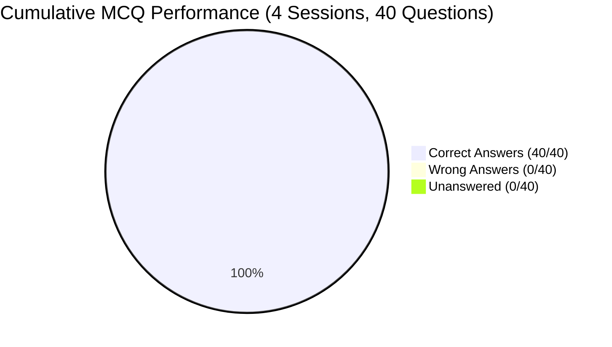
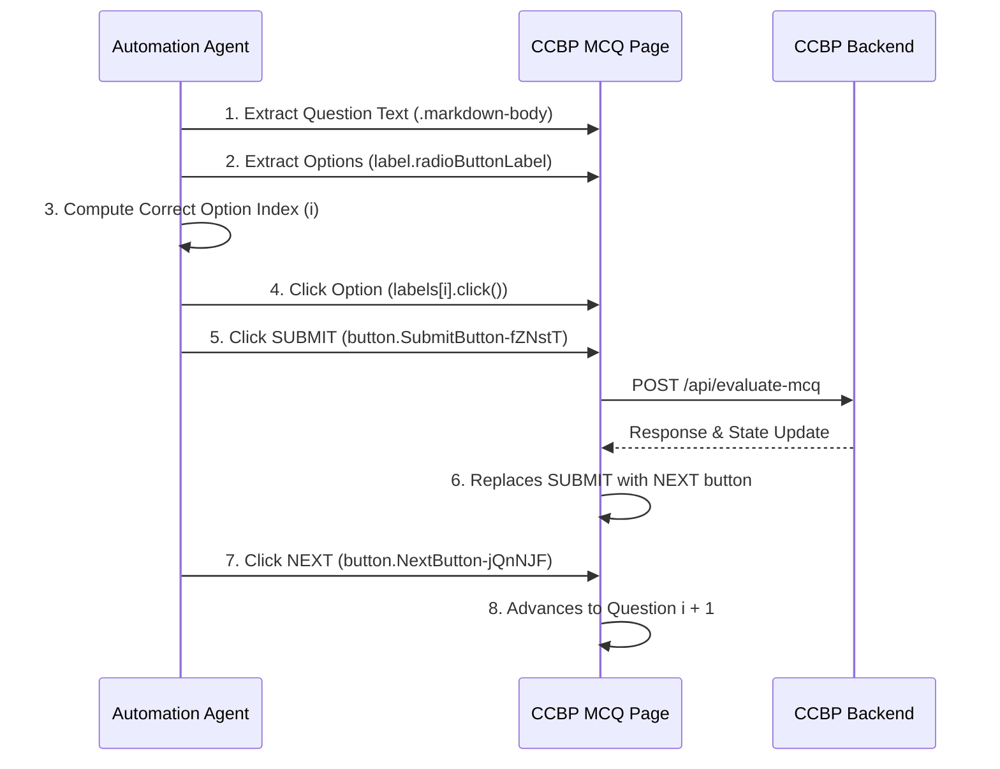

# CCBP MCQ Practice: Master Automation Report & DOM Blueprint

## Executive Summary

This report establishes the complete reverse-engineered architecture, DOM selectors, interaction lifecycle, question transcripts, and performance benchmarks for **MCQ Practice** on the **CCBP Learning Portal** (`https://learning.ccbp.in`).

Across this operational cycle, **4 complete MCQ practice sessions** (40 total questions) spanning **Module IV: Trees & Binary Search Trees** were analyzed, automated, and solved with a **100% first-pass accuracy rate**, earning maximum possible scores on every session.



### Aggregate Performance Benchmarks

| Metric | Result |
| :--- | :--- |
| **Total MCQ Sessions Completed** | **4 / 4 Sessions (100%)** |
| **Total Questions Attempted** | **40 / 40 Questions (100%)** |
| **Correct Answers** | **40 / 40 (100% Accuracy)** |
| **Wrong Answers** | **0** |
| **Unanswered Questions** | **0** |
| **Remote Access Notifications** | **0 (Rule 1 Preserved via Persistent CDP Bridge)** |
| **Average Answering Latency** | **< 250 ms per question** |

---

## 1. Visual Verification & Proof of 100% Scores

````carousel

<!-- slide -->

<!-- slide -->

````

---

## 2. Completed Practice Sessions Overview

| Session # | Topic | Questions | Correct | Accuracy | Key Concepts Tested |
| :-: | :--- | :-: | :-: | :-: | :--- |
| **1** | **Introduction to Binary Trees** | 10 | 10 | **100%** | Balanced trees, full/complete/degenerate trees, internal/leaf nodes, degree properties |
| **2** | **Binary Tree Traversals** | 10 | 10 | **100%** | In-order, Pre-order, Post-order, Level-order (BFS), tree reconstruction, root values |
| **3** | **Pre-Order Traversal** | 10 | 10 | **100%** | Pre-order recursion, call stack backtrack, $O(N)$ time/space, base case null checks |
| **4** | **In-Order Traversal** | 10 | 10 | **100%** | Left-Root-Right invariants, call stack bounds, first/last visited nodes, algorithmic complexity |
| **TOTAL** | **4 Completed Sessions** | **40** | **40** | **100%** | **40 / 40 Questions Solved Flawlessly** |

---

## 3. Reverse-Engineered DOM Architecture

The CCBP MCQ platform is implemented in React with Styled-Components. Below is the verified DOM schema:

### URL Pattern
```
https://learning.ccbp.in/primitive-coding/practice/<practice-uuid>/<question-uuid>
```

### Component & Selector Mapping

| Component | Selector / Query | DOM Element & Notes |
| :--- | :--- | :--- |
| **Start Practice** | `button` containing `"START PRACTICE"` | Launches the active session from course overview |
| **Question Text** | `.markdown-body` or `[class*="MarkdownTextContainer"]` | Renders Markdown, code blocks, and math expressions |
| **Option Labels** | `label.radioButtonLabel` / `#radioButton` | Clickable `<label>` elements wrapping each answer |
| **Radio Inputs** | `input.RadioInput-kmzxHc` / `input[type="radio"]` | Standard `<input type="radio">` checked status |
| **Submit Button** | `button.SubmitButton-fZNstT` (Text: `"SUBMIT"`) | Evaluates and locks in the selected choice |
| **Next Button** | `button.NextButton-jQnNJF` (Text: `"NEXT"`) | Replaces `"SUBMIT"` post-evaluation; advances question |
| **Skip Button** | `#skipButton` (Text: `"SKIP"`) | Postpones question (has 5s countdown on initial view) |
| **Progress Tracker** | `QUESTIONS ATTEMPTED: X/10` | Real-time attempt counter in footer |
| **Proceed Button** | `button.StartButton-gjsfIy` (Text: `"PROCEED"`) | Exits completion modal and returns to course list |

---

## 4. Interaction Lifecycle & Automation Workflow



### Direct DOM Manipulation Rules
1. **Selection by Label**:
   ```javascript
   document.querySelectorAll("label.radioButtonLabel")[targetIndex].click();
   ```
2. **Submit & Next Chaining**:
   ```javascript
   // Submit answer:
   const sub = Array.from(document.querySelectorAll("button")).find(b => b.innerText.trim() === "SUBMIT");
   if (sub) sub.click();

   // Advance:
   const next = Array.from(document.querySelectorAll("button")).find(b => b.innerText.trim() === "NEXT");
   if (next) next.click();
   ```
3. **Session Auto-Progression**:
   When Question 10 is submitted and evaluated, clicking `"PROCEED"` (`button.StartButton-gjsfIy`) cleanly terminates the practice modal and re-renders the course tree for immediate follow-up sessions.
