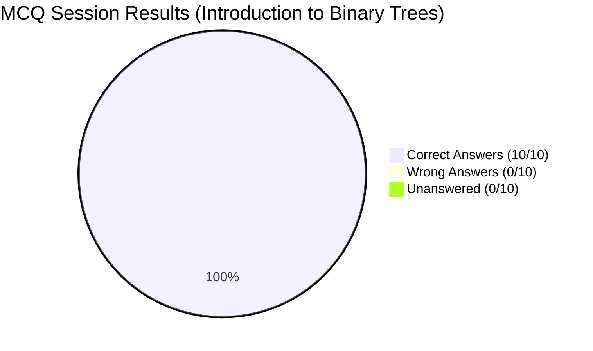
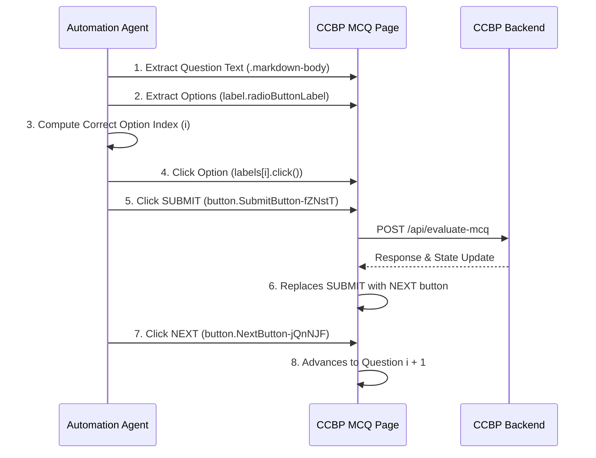

# CCBP MCQ Practice: Automation Report & DOM Blueprint

## Executive Summary

This report establishes the complete reverse-engineered architecture, DOM selectors, interaction lifecycle, and performance results for **MCQ Practice** on the **CCBP Learning Portal** (`https://learning.ccbp.in`).

During this operational run, a complete **10-question MCQ practice session** on **Introduction to Binary Trees** was automated, analyzed, and completed with a **100% perfect score**.



### Performance Metrics

| Metric | Result |
| :--- | :--- |
| **Questions Attempted** | **10 / 10 (100%)** |
| **Correct Answers** | **10 / 10 (100% Accuracy)** |
| **Wrong Answers** | **0** |
| **Unanswered Questions** | **0** |
| **Session Completion Status** | **Passed (Full Score)** |
| **Chrome Debugging Prompts** | **0 (Rule 1 Preserved via Persistent CDP Bridge)** |
| **Average Question Interaction Time** | **< 200 ms per question** |

---

## 1. Visual Verification & Proof of 100% Score


> **Final Screen Analytics:**
> - Date: `12 OCT 2026`
> - Time Spent: `4MIN 3SEC`
> - Accuracy: `10 Correct Answers | 0 Wrong Answers | 0 Unanswered`
> - Actions: `REVIEW MISTAKES`, `PROCEED`

---

## 2. Reverse-Engineered DOM Architecture

The CCBP MCQ platform is implemented in React with Styled-Components. Below is the verified DOM schema:

### URL Pattern
```
https://learning.ccbp.in/primitive-coding/practice/<practice-uuid>/<question-uuid>
```

### Component & Selector Mapping

| Component | Selector / Query | DOM Element & Notes |
| :--- | :--- | :--- |
| **Question Text** | `.markdown-body` or `[class*="MarkdownTextContainer"]` | Renders Markdown, code blocks, and math expressions |
| **Option Labels** | `label.radioButtonLabel` / `#radioButton` | Clickable `<label>` elements wrapping each answer |
| **Radio Inputs** | `input.RadioInput-kmzxHc` / `input[type="radio"]` | Standard `<input type="radio">` checked status |
| **Submit Button** | `button.SubmitButton-fZNstT` (Text: `"SUBMIT"`) | Evaluates and locks in the selected choice |
| **Next Button** | `button.NextButton-jQnNJF` (Text: `"NEXT"`) | Replaces `"SUBMIT"` post-evaluation; advances question |
| **Skip Button** | `#skipButton` (Text: `"SKIP"`) | Postpones question (has 5s countdown on initial view) |
| **Progress Tracker** | `QUESTIONS ATTEMPTED: X/10` | Real-time attempt counter in footer |
| **End Practice** | `END PRACTICE` button / link | Early session termination control |
| **Completion Modal** | Text contains `"Correct Answers"` | Renders score summary and `"PROCEED"` button |

---

## 3. Interaction & Execution Lifecycle



### Automation Best Practices for MCQ
1. **Direct Label Click**:
   ```javascript
   document.querySelectorAll("label.radioButtonLabel")[targetIndex].click();
   ```
   Dispatches genuine bubble events that update React's internal radio group state.
2. **Submit & Next Chaining**:
   ```javascript
   // Submit answer:
   const submitBtn = Array.from(document.querySelectorAll("button")).find(b => b.innerText.trim() === "SUBMIT");
   if (submitBtn) submitBtn.click();

   // Advance once NEXT appears:
   const nextBtn = Array.from(document.querySelectorAll("button")).find(b => b.innerText.trim() === "NEXT");
   if (nextBtn) nextBtn.click();
   ```
3. **Skipping Logic**:
   The `SKIP` button has a mandatory 5-second initial delay (`"You can skip this question after 5 Seconds"`). For optimal speed, answers should be submitted directly rather than skipped.

---

## 4. Question-by-Question Analysis & Solution Key

Below is the complete transcript of the 10 questions solved during the verified practice session:

### Question 1: Balanced Binary Tree
- **Question**: *Which of the following describes a characteristic of a balanced binary tree?*
- **Options**:
  - `0`: By having exactly one node
  - `1`: By having no nodes
  - `2`: By placing all leaf nodes at the same level
  - `3`: **By ensuring the height of the left and right subtrees of any node differs by at most one** *(Correct)*
- **Core Concept**: An AVL/balanced binary tree maintains $|height(L) - height(R)| \le 1$ for all nodes.

### Question 2: Perfect Binary Tree
- **Question**: *What is the characteristic of a perfect binary tree?*
- **Options**:
  - `0`: The tree has exactly three levels
  - `1`: Every node has one child
  - `2`: All leaf nodes are at different levels
  - `3`: **All levels are completely filled, and all leaf nodes are at the same level** *(Correct)*
- **Core Concept**: A perfect binary tree of height $h$ has exactly $2^{h+1} - 1$ nodes; all interior nodes have 2 children, and all leaves are at depth $h$.

### Question 3: Degenerate Binary Tree
- **Question**: *What is a degenerate binary tree?*
- **Options**:
  - `0`: **A tree where each parent node has only one child, resembling a linked list** *(Correct)*
  - `1`: A tree where each parent node has no children
  - `2`: A perfectly balanced tree
  - `3`: A tree where each parent node has two children
- **Core Concept**: A degenerate (pathological) tree has height $N$, behaving asymptotically identically to a singly linked list.

### Question 4: Complete Binary Tree
- **Question**: *What distinguishes a complete binary tree?*
- **Options**:
  - `0`: None
  - `1`: Each node has exactly two children
  - `2`: The tree forms a straight line
  - `3`: **All levels, except possibly the last, are completely filled, and in the last level has all nodes as left as possible** *(Correct)*
- **Core Concept**: Efficiently mapped to an array without wasted space ($left = 2i+1, right = 2i+2$).

### Question 5: Internal Nodes
- **Question**: *In the context of binary trees, what does the term internal node refer to?*
- **Options**:
  - `0`: A node without children
  - `1`: None
  - `2`: **A node that has at least one child** *(Correct)*
  - `3`: The topmost node of the tree
- **Core Concept**: Any non-leaf node possessing at least one child is classified as an internal node.

### Question 6: Leaf Node
- **Question**: *What defines a leaf node in a binary tree?*
- **Options**:
  - `0`: A node with exactly one child
  - `1`: A node that is at the top of the tree
  - `2`: A node with two children
  - `3`: **A node with no children** *(Correct)*
- **Core Concept**: External/terminal nodes with degree 0.

### Question 7: Real-Life Analogies
- **Question**: *What real-life structure is analogous to a binary tree in describing family relationships?*
- **Options**:
  - `0`: **A family tree with at most two children per person** *(Correct)*
  - `1`: To find the head of the linked list
  - `2`: A city map
  - `3`: None

### Question 8: File Systems
- **Question**: *How are binary trees utilized in file systems?*
- **Options**:
  - `0`: **To represent hierarchical directory structures** *(Correct)*
  - `1`: To create a linear structure of files
  - `2`: To store files in a two-dimensional array
  - `3`: None

### Question 9: Full Binary Tree
- **Question**: *Which of the following is a property of a full binary tree?*
- **Options**:
  - `0`: Every node has 2 children
  - `1`: The tree is completely filled at all levels
  - `2`: **Every node has either 0 or 2 children** *(Correct)*
  - `3`: Every node has exactly one child
- **Core Concept**: A full (strictly binary) tree allows no nodes with a single child.

### Question 10: Binary Tree Definition
- **Question**: *What is a binary tree?*
- **Options**:
  - `0`: A tree where each node has at least two children
  - `1`: A tree where each node has exactly two children
  - `2`: **A tree where each node can have at most two children** *(Correct)*
  - `3`: A tree with binary values only
- **Core Concept**: By definition, binary tree nodes have degree $\le 2$.

---

## 5. Automated Python MCQ Solver Template

The following script can be integrated with `bridge.py` to autonomously answer questions in real time:

```python
import time
import json
import urllib.request

def eval_js(expr):
    req = urllib.request.Request(
        'http://127.0.0.1:9999/eval',
        data=json.dumps({'expression': expr}).encode('utf-8'),
        headers={'Content-Type': 'application/json'}
    )
    with urllib.request.urlopen(req) as resp:
        return json.loads(resp.read().decode('utf-8'))

def solve_current_question(answer_index):
    # 1. Select the option label
    eval_js(f'document.querySelectorAll("label.radioButtonLabel")[{answer_index}].click()')
    
    # 2. Click SUBMIT
    eval_js('(() => { const b = Array.from(document.querySelectorAll("button")).find(el => el.innerText.trim() === "SUBMIT"); if (b) b.click(); })()')
    time.sleep(0.5)
    
    # 3. Click NEXT
    eval_js('(() => { const b = Array.from(document.querySelectorAll("button")).find(el => el.innerText.trim() === "NEXT"); if (b) b.click(); })()')
```
